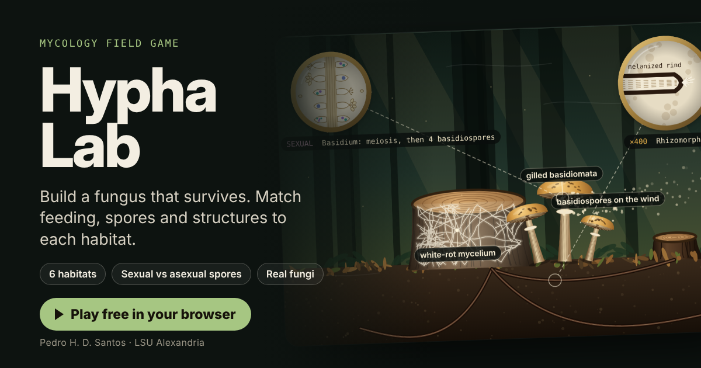

# Hypha Lab

Hypha Lab: a mycology game. Choose the feeding mode, spore-producing structure, dispersal and key structure that let a fungus survive six real habitats.

**Play it:** https://phdiassantos.github.io/hypha-lab/

Made by Dr. Pedro H. D. Santos, Department of Biological Sciences, Louisiana State University of Alexandria, for mycology teaching (BIOL 3999). Free to use in class.

Runs in any modern browser on desktop or phone. No install and no sign-in; scores are saved only in the player's own browser.
